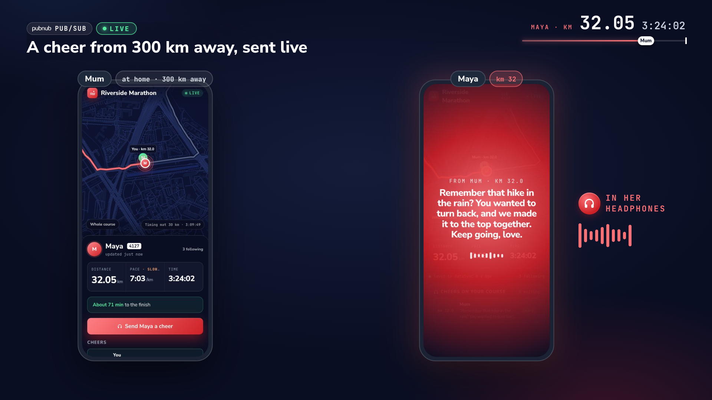
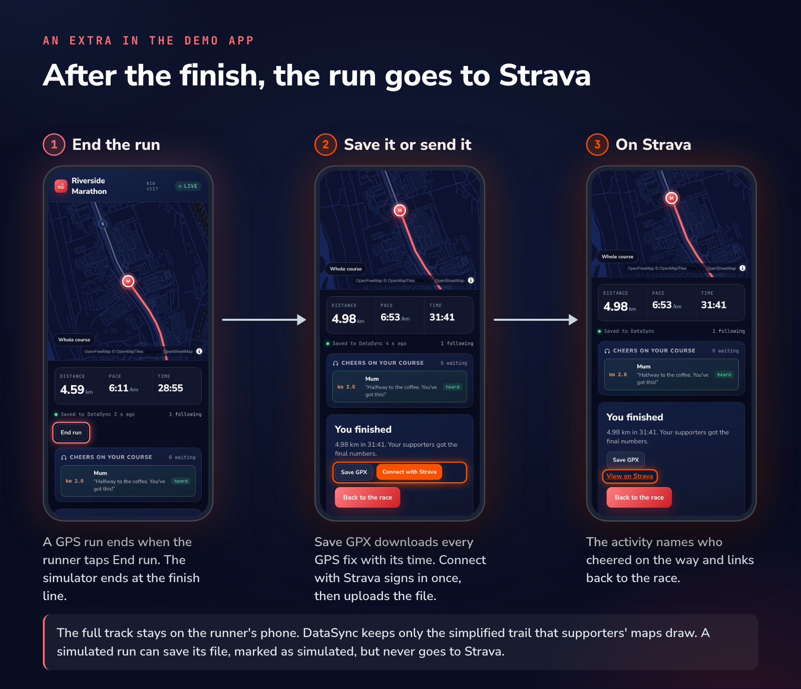

# Riverside Marathon: cheers in your headphones

[Try the demo](https://marathon-datasync-demo.netlify.app/) · [Local setup](docs/setup.md) · [API reference](docs/reference.md)

Supporters follow a runner on a live map and leave cheers along the course. Her phone reads each cheer when she reaches it. The race is fictional; the PubNub calls are real.



[Image description](docs/image-descriptions.md#cover-kilometre-32)

## Try it in two windows

1. Open the demo, enter a name and choose **Simulate race day**.
2. Open its supporter link in another window, then press **Start** on the runner's page.
3. Send a cheer now or pin one ahead. Under **Under the hood**, skip ahead 5 km, send an empty GPS fix, or try to record a finish.

## What runs where

The browser uses the PubNub JavaScript SDK. DataSync holds the live records; Pub/Sub carries cheer notices; Access Manager checks tokens. No application database is needed.


[Image description](docs/image-descriptions.md#fig-architecture)

The diagram shows local mode. The hosted Netlify demo uses our shared Access Manager for sessions, runner-link verification and timing. See [deployment and credentials](docs/setup.md#deploy-on-netlify).

## One write updates the following phones


[Image description](docs/image-descriptions.md#fig-one-write)

[Subscription and reconnect code](docs/reference.md#events)

## Two classes describe the state


[Image description](docs/image-descriptions.md#fig-classes)

[Runner and Cheer fields](docs/reference.md#the-data) · [Class definitions](scripts/)

## Each person gets a scoped token


[Image description](docs/image-descriptions.md#fig-tokens)

[Complete grants and token refresh](docs/reference.md#roles)

## Permissions apply to individual fields


[Image description](docs/image-descriptions.md#fig-field-permissions)

[Official timing](docs/reference.md#official-times)

## A reconnect reads the current record


[Image description](docs/image-descriptions.md#fig-reconnect)

## Bad writes leave the stored record unchanged


[Image description](docs/image-descriptions.md#fig-refused)

[Try a REST PATCH](docs/reference.md#try-the-api-with-curl)

## A cheer combines stored state and a live notice


[Image description](docs/image-descriptions.md#fig-cheer-flow)

[Cheer events](docs/reference.md#events) · [Headphones voice and browser fallback](docs/reference.md#the-headphones-voice)

## Keep the finished run



[Image description](docs/image-descriptions.md#fig-strava-export)

For a GPS run, press **End run**, then **Save GPX** to download the timestamped track recorded by this browser. The full track stays in local storage; DataSync holds the simplified trail used on supporters' maps. Export needs at least two recorded points. The app saves points periodically and when the page closes or the run finishes. Saved points survive a reload in the same browser when local storage is available; they do not transfer to another device.

Direct Strava upload is optional. With `STRAVA_CLIENT_ID` and `STRAVA_CLIENT_SECRET` configured on the server, a GPS runner can connect Strava, authorize uploads and send the GPX. Without those credentials, GPX download works on its own. Simulated exports are labeled simulated, and their finish screen offers GPX download without a Strava upload button. See [Strava setup](docs/setup.md#strava-export).

## Video review copy

[Watch the original 91-second film](https://youtu.be/NK_JBg687Go). This YouTube copy is private and requires access; it is not a public embed. The fictional race uses real PubNub calls. The film predates GPX and Strava export.

## Run locally or deploy

Use Node.js 22 or newer. Clone the repository, then follow [keyset setup](docs/setup.md#set-up-your-keyset) before running the app:

```sh
git clone https://github.com/PubNubDevelopers/Marathon-DataSync-Demo.git
cd Marathon-DataSync-Demo
npm ci
cp .env.example .env.local
```

The setup guide covers credentials, schema creation, class events, `npm run check`, `npm run dev`, and [Netlify deployment](docs/setup.md#deploy-on-netlify).

## Image descriptions for people and agents

Every image has alt text. The [description catalog](docs/image-descriptions.md) records layouts, labels, arrows, values and permission details for all 19 images. Agents can read the [JSON catalog](docs/images/descriptions.json) without interpreting pixels.

## Credits

Map tiles: [OpenFreeMap](https://openfreemap.org). Map data: © [OpenStreetMap](https://www.openstreetmap.org/copyright) contributors; [course and ODbL details](data/COURSE.md). Fonts: [Nunito Sans](public/fonts/NunitoSans-OFL.txt) and [JetBrains Mono](public/fonts/JetBrainsMono-OFL.txt), SIL Open Font License.
